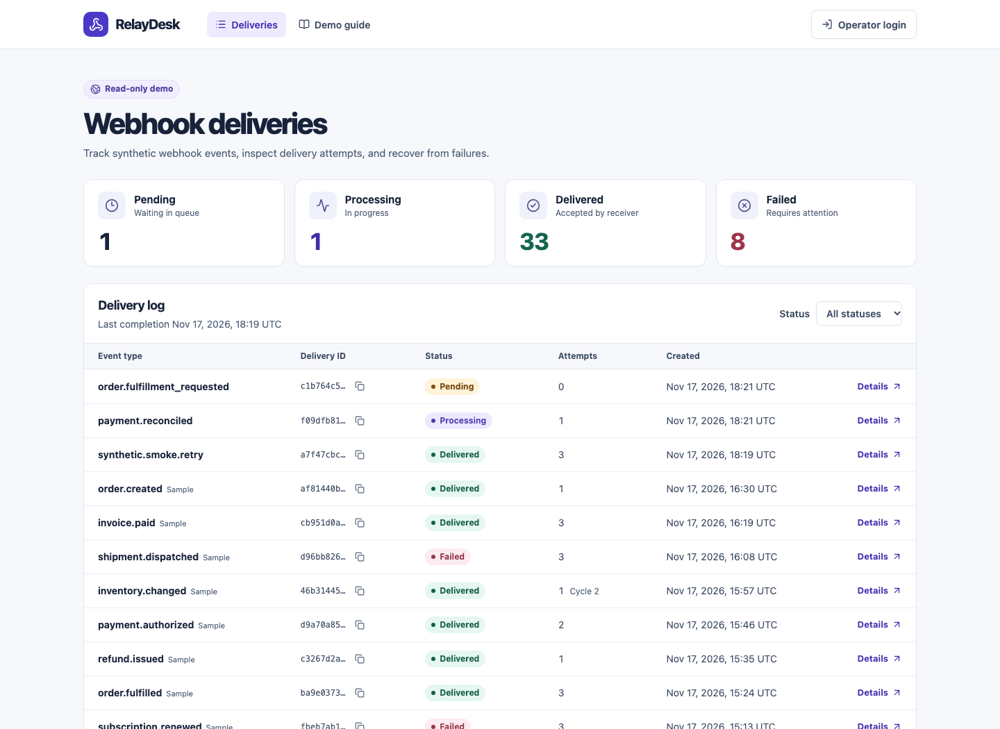

# RelayDesk

RelayDesk is a portfolio demo for investigating missed webhooks. Submit a synthetic event, watch a separate worker deliver it, inspect errors, and replay a failed delivery while keeping its history.



[Retry history screenshot](docs/screenshots/retry-history.png) · [Two-minute demo](docs/demo.md) · [Architecture](docs/architecture.md) · [Deployment](docs/deployment.md) · [Verification evidence](STATUS.md)

## Run the packaged app

Prerequisites are Docker with Compose and ports 3000 and 5432 available. Start from the repository root.

```sh
cp .env.example .env
docker compose up --build --wait -d
docker compose run --rm --no-deps web node dist/prisma/seed.js
curl --fail http://localhost:3000/api/health
```

Open [the local dashboard](http://localhost:3000). The public view lists synthetic delivery history. Choose **Operator login** and enter the local `OPERATOR_CREDENTIAL` from `.env` to create events and replay failures. Compose starts PostgreSQL, runs migrations once, and then starts the web and worker services. The explicit seed command is safe to repeat after operator activity.

For alternate host ports, set `WEB_PORT` and `POSTGRES_PORT` in `.env`. Match `APP_ORIGIN` to the web port and update the host database URLs if using source commands.

Use `docker compose logs -f web worker` for process logs and `docker compose down` to stop the app while retaining the database volume.

## Run from source

Use Node 22.13+ in the 22.x line and npm. The project uses the checked-in npm lockfile. For a first run, create `.env` from the example.

```sh
cp .env.example .env
npm ci
npm run db:generate
docker compose up --wait -d db
npm run db:migrate
npm run db:seed
```

Start the two processes in separate terminals.

```sh
npm run dev -- --hostname 127.0.0.1
```

```sh
npm run worker:dev
```

For the production build, run `npm run build`, then start `HOSTNAME=127.0.0.1 npm start` and `npm run worker` in separate terminals. Use the same URL for `APP_ORIGIN` and `RECEIVER_BASE_URL` when both processes run on the host. An existing PostgreSQL 15+ server can replace Compose. Create the databases with its administration tools and update the URLs in `.env`.

## Verify

Create the disposable database once and install the Playwright browser.

```sh
docker compose exec -T db createdb -U relaydesk relaydesk_test
npx --no-install playwright install chromium
npm run verify
```

On Linux, use `npx --no-install playwright install --with-deps chromium` to install required system libraries as well. If using an existing PostgreSQL server, create a separate database with a name ending in `_test` and update `TEST_DATABASE_URL`.

`npm run verify` runs lint, strict type checking, unit tests, the production build, disposable migrations, PostgreSQL/HTTP integration tests, and Chromium journeys against the built web and worker. It refuses a test database with the same name as the runtime database and uses only `TEST_DATABASE_URL` for test writes and cleanup. In isolation, `npm run test:integration` and `npm run test:e2e` also build the production app and migrate the test database.

Run `npm run smoke` against a running instance using its `APP_ORIGIN` and `API_TOKEN`. The smoke creates a synthetic delivery and prints its detail URL after it observes HTTP 503, 503, and 200.

## Hosting

The local release uses the same build for the web and worker. The [deployment guide](docs/deployment.md) gives the container commands, environment, and current hosting status.
