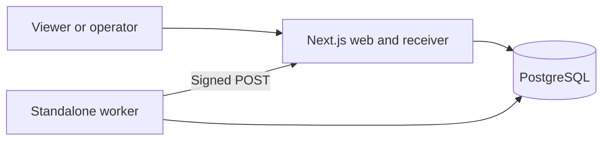

# RelayDesk architecture

The Next.js web process serves the dashboard, mutation APIs, and health check. Demo mode also serves the controlled receiver. The independent TypeScript worker polls PostgreSQL and sends HTTP requests to the web process. PostgreSQL is the durable queue and history.



## Schema and submission

- `Workspace` stores the workspace identity and a digest of the generated sign-in code. Each workspace has one approved `Endpoint`. The event API resolves that endpoint from the signed-in workspace or bearer key. Demo mode uses its fixed seeded workspace and receiver.
- `ApiKey` stores a workspace-scoped token digest, prefix, and revocation timestamp.
- `Event` keeps the validated event type and JSON payload, the exact canonical envelope, and a SHA-256 fingerprint of the submitted event type, payload, and original receiver mode.
- `Delivery` holds the queue state, current cycle, attempt count, due time, receiver mode, and lease. It is unique by event and endpoint.
- `DeliveryAttempt` records each claim, outcome, mode, timing, and bounded error. It is unique by delivery, cycle, and attempt number. IDs use UUIDs, dates use `timestamptz`, and history relations restrict deletion.

The event and delivery commit together. The event insert passes canonical JSON text to PostgreSQL so that JSON object keys survive intact. A duplicate workspace/key rolls back the write transaction before the service reads the committed event. The same fingerprint returns the original IDs and different input returns HTTP 409. Replay leaves the original event and fingerprint intact.

Private reads require a session and scope every query to that workspace. The isolated demo reads only its fixed synthetic workspace. Reads select only display fields. PostgreSQL groups counts by status and computes the latest recorded attempt completion. The list uses a descending `createdAt, id` keyset cursor with a default of 25 and maximum of 50 rows. Detail history caps at 12 attempts, the maximum across four cycles. The browser polls every three seconds while visible.

## Worker lifecycle

1. Recover up to 20 expired leases in a transaction with row locks. Change the corresponding STARTED attempt to UNKNOWN, consume its attempt budget, and reschedule or fail the delivery.
2. Lock one due row using `FOR UPDATE SKIP LOCKED`. Mark it PROCESSING, create a STARTED attempt, and assign a random 30-second lease. Commit before sending.
3. POST the immutable body to the approved HTTPS destination. The worker validates every DNS answer and connects to one validated public address while preserving TLS hostname verification. The demo worker sends to the fixed `/api/demo/receiver` route. Both use a three-second deadline, stop at redirects, and discard response bodies.
4. In another transaction, lock the matching delivery and confirm the cycle, token, and unexpired lease against database time before updating the attempt and delivery. An expired or replaced lease produces a stale-completion log and leaves the newer state intact.
5. An operator can requeue a FAILED delivery with a conditional update. Replay increments the cycle, resets the attempt count, preserves the same event/body and all history, and routes to the same destination. In demo mode, an operator may change the simulation mode for a replay. A delivery can be replayed for up to three extra cycles.

Database time governs claim eligibility, recovery, finalization, and replay scheduling. A worker processes one outstanding send at a time. Each process uses one Prisma client and defaults to four pool connections. The queue indexes cover due work and expired leases, and a separate index supports the created-time list.

## Retries and crash semantics

| Outcome | Action |
| --- | --- |
| HTTP 2xx | Mark delivered |
| HTTP 408, 429, 5xx, timeout, or network failure | Retry if budget remains |
| Other HTTP statuses, including redirects | Fail the cycle immediately |
| Expired worker lease | Record UNKNOWN and retry if budget remains |

The maximum is three attempts per cycle. Backoff after attempts 1 and 2 is 5 and 15 seconds. A functioning worker attempts accepted work at least once. The receiver may accept a request before its sender crashes or times out, so duplicates are possible. UNKNOWN describes a missing conclusive outcome. The simulated receiver has no business side effects. Real receivers need idempotency for those effects.

## Request signing

The worker computes HMAC-SHA-256 using the destination-specific secret in private mode or `RECEIVER_SECRET` in demo mode. It signs this UTF-8 message.

```text
JSON.stringify(["relaydesk-v1", eventId, deliveryId, cycle, attempt, unixTimestamp, mode])
<one LF byte>
<exact immutable body bytes>
```

The metadata travels in `X-RelayDesk-Event`, `X-RelayDesk-Delivery`, `X-RelayDesk-Cycle`, `X-RelayDesk-Attempt`, `X-RelayDesk-Timestamp`, and `X-RelayDesk-Mode`. `X-RelayDesk-Signature` carries `v1=` followed by the 64 lowercase hexadecimal digest characters. The timestamp is integer Unix seconds. The demo receiver validates metadata shapes and ranges, checks the five-minute window, compares the digest in constant time, and matches the signed event ID to the JSON envelope before applying fault behavior.

## Access and known limits

Private workspaces use encrypted, authenticated four-hour HttpOnly SameSite=Lax cookies with Secure set for HTTPS. Session mutations and login require the configured origin. API clients authenticate event submission with a revocable workspace bearer key. Login uses a process-local budget of five failed attempts per minute per workspace. A deployment can rotate the session secret to invalidate issued cookies across all clients. The demo uses its own synthetic workspace, receiver, and credentials.

Both modes use fixed retries, three extra replay cycles, and sequential workers. Jitter and honoring `Retry-After` are deferred. Queue semantics allow duplicate sends and provide no delivery ordering guarantee.

Technical references include the [PostgreSQL row-locking clause](https://www.postgresql.org/docs/current/sql-select.html#SQL-FOR-UPDATE-SHARE), [Prisma transactions](https://www.prisma.io/docs/orm/fundamentals/transactions), and [Next.js self-hosting](https://nextjs.org/docs/app/guides/self-hosting).
